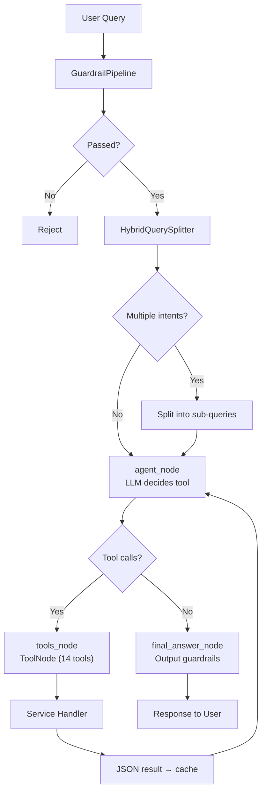

# Financial Insight Agent

**LLM Agent for Vietnamese Stock Analysis**

Financial Insight Agent là hệ thống AI phân tích chứng khoán sử dụng **LangGraph ReAct agent** với tool-calling LLM, trả lời câu hỏi tiếng Việt về thị trường chứng khoán dựa trên dữ liệu thời gian thực.

---

## 🚀 Project Overview

- Hệ thống trợ lý tài chính sử dụng **LLM agent** (ReAct pattern) để phân tích và trả lời câu hỏi chứng khoán Việt Nam.
- Agent được xây dựng với **LangGraph StateGraph**, có khả năng tự động quyết định gọi tool nào dựa trên ngữ cảnh.
- Hỗ trợ 14 loại truy vấn: giá, chỉ báo kỹ thuật, thông tin công ty, so sánh, xếp hạng, tổng hợp, tỷ lệ tài chính, tin tức, danh mục, cảnh báo, dự báo, phân tích ngành, tra cứu kiến thức pháp luật/giáo dục, vẽ biểu đồ dashboard.
- Tích hợp: input/output guardrails, circuit breaker, Redis caching, structured logging, metrics, rate limiting.

---

## 💡 Vì sao dự án này tồn tại? — Pain Point Giáo dục Tài chính

> Dự án chuyển từ "demo kỹ thuật ReAct agent" sang **giải bài toán thực tế có bằng chứng**: giúp nhà đầu tư cá nhân Việt Nam ra quyết định có căn cứ, có trích dẫn — thay vì giao dịch cảm tính. Toàn bộ số liệu dưới đây đều có nguồn công khai để bạn tự kiểm chứng.

### 1. Quy mô thị trường — 11–13 triệu tài khoản, tăng rất nhanh

Số tài khoản chứng khoán cá nhân trong nước tăng liên tục: **11,8 triệu cuối 2025** (~11% dân số, tăng thêm 2,6 triệu chỉ trong năm 2025) [Thời báo Tài chính Việt Nam](https://thoibaotaichinhvietnam.vn/so-luong-tai-khoan-chung-khoan-cua-nha-dau-tu-trong-nuoc-da-tang-gan-26-trieu-tai-khoan-trong-nam-2025-190337.html) → vượt mốc **12 triệu (02/2026)** [Vietstock](https://vietstock.vn/2026/02/so-luong-tai-khoan-chung-khoan-tai-viet-nam-vuot-moc-12-trieu-830-1401652.htm) → vượt **13 triệu (05/2026, ~13% dân số)** [Báo Nhân Dân / VSDC](https://baomoi.com/tinh-toi-het-thang-5-2026-viet-nam-chinh-thuc-vuot-moc-13-trieu-tai-khoan-chung-khoan-c55354494.epi). Đây là nhóm người dùng tiềm năng cực lớn và vẫn đang tăng ~13%/năm.

### 2. Hiểu biết tài chính thấp & thiếu kế hoạch dài hạn — có số liệu định lượng

- **S&P Global FinLit Survey 2014** (140 quốc gia): Việt Nam chỉ **24%** dân số trưởng thành hiểu biết tài chính cơ bản — thấp hơn Thái Lan 27%, Indonesia 32%, Malaysia 36%, Singapore 59% [div.gov.vn](https://div.gov.vn/day-manh-pho-cap-tai-chinh-tai-viet-nam).
- **Sun Life Financial Resilience Index 2026**: **59%** người tiêu dùng Việt tự đánh giá kiến thức tài chính chỉ ở mức cơ bản/thấp; nhóm "năng lực tài chính cao" giảm từ 34% (2025) xuống 31% (2026) [Điện tử & Ứng dụng](https://dientuungdung.vn/chi-so-nang-luc-tai-chinh-2026-kha-nang-chong-chiu-tai-chinh-cua-nguoi-viet-vuot-nhieu-thi-truong-trong-khu-vuc-16320.html).
- **TVS "Sức khỏe Tài chính & Niềm tin Đầu tư 2026"** (1.000 người, 5 TP lớn): chỉ **27% có kế hoạch tài chính dài hạn rõ ràng, 73% chưa có** (Sun Life 2026 đưa con số tương tự: 61% không có kế hoạch hoặc chỉ <1 năm); **95% chưa từng dùng dịch vụ tư vấn tài chính trả phí chuyên nghiệp**; "ảo giác an toàn" (85% tự tin xoay được tiền mặt nhưng ~1/2 chỉ thanh khoản được ≤40% tài sản trong 30 ngày); "đa dạng hóa giả" (55% nắm 2–3 kênh, 39% nắm 4–5 kênh nhưng tỉ trọng cổ phiếu/trái phiếu/chứng chỉ quỹ/ngoại tệ vẫn <10%) [Nhịp Cầu Đầu Tư](https://nhipcaudautu.vn/tai-chinh/di-cung-f0/quan-tri-tai-san-va-nghich-ly-cua-niem-tin-3365371/).

> Con số **95% chưa dùng tư vấn trả phí** là quan trọng nhất: nhu cầu định hướng có thật nhưng kênh tư vấn truyền thống gần như không chạm tới số đông.

### 3. Hành vi giao dịch cảm tính, thiếu kỷ luật cắt lỗ

Nhiều nguồn mô tả mẫu hình lặp lại ở nhà đầu tư F0: *"lãi thì chốt non, lỗ thì gồng tới chết"*, thiếu kỷ luật cắt lỗ, dễ cuốn theo tin đồn mạng xã hội [DSC](https://www.dsc.com.vn/kien-thuc/nha-dau-tu-f0-la-gi) [Prudential](https://www.prudential.com.vn/vi/blog-nhip-song-khoe/quan-ly-tai-chinh/nha-dau-tu-f0-la-gi-huong-dan-cho-nguoi-moi-bat-dau/).

> **Lưu ý trích dẫn:** Các con số giật gân như *"90% F0 mất 90% tài sản trong 90 ngày"* hay *"95% NĐT thua lỗ"* xuất hiện trên [Lao Động](https://specials.laodong.vn/90-nha-dau-tu-chung-khoan-f0-mat-90-tai-san-trong-90-ngay-dau-tien-930926/) và trang đào tạo/môi giới nhưng **không có phương pháp khảo sát gốc công khai** — nên dùng như **tín hiệu định tính** về mẫu hình hành vi, không nên trích như thống kê chính xác (đúng khuyến nghị trong tài liệu Pain-Point gốc).

### 4. Bằng chứng sẵn sàng chi trả + Lực đẩy AI mạnh nhất

- **Giá cụ thể:** Simplize — nền tảng phân tích/định giá phổ biến — gói **Premium 499.000đ/tháng** (bên cạnh gói Basic miễn phí) [Vua Chứng Khoán](https://vuachungkhoang.com/simplize/) [seiofva](https://seiofva.com/simplize/) [Simplize](https://simplize.vn/).
- **Vốn vào robo-advisor/app đầu tư nhỏ lẻ:** Finhay (từ 50.000đ), Passion Invest, Tikop, Infina được hậu thuẫn bởi TVS/DNSE — nhưng **UBCKNN 2022 đã cảnh báo** các app này có dấu hiệu hoạt động quản lý quỹ/danh mục khi chưa được cấp phép [Tuổi Trẻ](https://tuoitre.vn/than-trong-voi-ung-dung-dau-tu-finhay-passion-invest-duoc-nguoi-noi-tieng-quang-cao-20221005202138199.htm) [MarketTimes](https://markettimes.vn/dich-vu-cua-passion-invest-finhay-tikop-infina-savenow-buff-chua-duoc-uy-ban-chung-khoan-nha-nuoc-cap-phep-5149.html) — **ranh giới pháp lý quan trọng** nếu sản phẩm đưa khuyến nghị mua/bán cụ thể hoặc quản lý tiền hộ.
- **Tailwind đặc biệt cho AI agent:** **75% người tiêu dùng Việt đã dùng Generative AI để tìm lời khuyên tài chính — tỉ lệ cao nhất khu vực**, 73% dự định tăng dùng trong 12 tháng tới (cũng cao nhất) [Sun Life 2026 — Điện tử & Ứng dụng](https://dientuungdung.vn/chi-so-nang-luc-tai-chinh-2026-kha-nang-chong-chiu-tai-chinh-cua-nguoi-viet-vuot-nhieu-thi-truong-trong-khu-vuc-16320.html). Thị trường không cần "thuyết phục dùng AI cho tài chính" — họ đã dùng rồi, câu hỏi là *dùng công cụ nào đáng tin hơn*.

### 5. Định vị của Financial Insight Agent — Giáo dục có trích dẫn

Thay vì cạnh tranh trực tiếp với Simplize về dữ liệu hay đưa khuyến nghị mua/bán (vướng UBCKNN), dự án chọn **Hướng C — Cổng giáo dục tài chính có trích dẫn**:

- RAG trên tài liệu giáo dục/quy định chính thống, **mọi con số trong câu trả lời đều kèm citation** `[TICKER: …, nguồn: …]`.
- Tận dụng eval harness sẵn có (`evals/` — golden dataset 36 cases, RAGAS, `citation_rate` / `numeric_match_rate` / `faithfulness`) để chứng minh độ tin cậy có kiểm chứng.
- Là "gateway" chi phí thấp cho **nhóm 95% chưa dùng tư vấn trả phí** trước khi tính đến tính năng nhạy cảm hơn về pháp lý.

> **Cam kết:** Chỉ phục vụ **giáo dục & thông tin**, không phải lời khuyên đầu tư. Mọi khuyến nghị cá nhân hóa (nếu có) sẽ gắn disclaimer và ngưỡng rủi ro do người dùng khai báo.

### Nội dung giáo dục: 8 modules

- **M1 — Quản lý ngân sách & theo dõi chi tiêu:** ba phương pháp lập ngân sách (50/30/20, zero-based, phong bì), phân loại nhu cầu/mong muốn, theo dõi theo danh mục.
- **M2 — Quỹ khẩn cấp & thói quen tiết kiệm:** quy mô quỹ 3–6 tháng chi phí, mục tiêu theo kỳ hạn, nguyên tắc trả lương cho bản thân trước.
- **M3 — Quản lý nợ & tín dụng:** phân biệt nợ tốt/xấu, chiến lược trả nợ snowball vs avalanche, đọc lãi suất/phí/kỳ hạn, dùng thẻ tín dụng và điểm tín dụng CIC.
- **M4 — Ngân hàng & sản phẩm tài chính cơ bản:** tài khoản thanh toán vs tiết kiệm, lãi suất danh nghĩa vs thực, phí ngân hàng và dùng ví điện tử an toàn.
- **M5 — Bảo hiểm:** bản đồ các loại bảo hiểm cá nhân, sàng lọc nhu cầu thật vs bán kèm, đọc quyền lợi/loại trừ/thời gian chờ trong hợp đồng.
- **M6 — Thuế thu nhập cá nhân & nghĩa vụ tài chính:** đối tượng nộp thuế, cách tính cơ bản, giảm trừ/miễn thuế thường gặp, kê khai và lưu chứng từ.
- **M7 — Tâm lý học tiền bạc & hành vi tiêu dùng:** thiên kiến gây chi tiêu bốc đồng, áp lực quảng cáo/mạng xã hội, mục tiêu SMART và nhận diện lừa đảo tài chính.
- **M8 — Lập kế hoạch tài chính cá nhân dài hạn (không đầu tư):** mục tiêu theo giai đoạn đời, ước tính chi phí hưu trí, chuẩn bị cho các sự kiện lớn.

> **Disclaimer:** Nội dung chỉ mang tính **giáo dục, không khuyến nghị sản phẩm tài chính cụ thể** (TT 135/2025/TT-BTC). Các con số về thuế/lãi suất phải tra nguồn hiện hành trước khi xuất bản. Chi tiết chương trình xem [curriculum_tai_chinh_ca_nhan.json](data/lessons/curriculum_tai_chinh_ca_nhan.json).

---

## ✨ Features

### Agent Pipeline (LangGraph ReAct)

```
HybridSplitter → agent_node ⇄ tools_node (loop) → final_answer → END
```

- **HybridSplitter**: Tách câu hỏi đa intent thành các sub-query độc lập (rule-based + LLM fallback).
- **agent_node**: LLM (OpenAI GPT-4o-mini, fallback Groq Llama) tự động quyết định tool cần gọi.
- **tools_node**: LangGraph `ToolNode` chứa 18 `@tool` functions.
- **final_answer_node**: Output guardrails + sanitization.

### Tool Types

Agent tự động chọn tool phù hợp dựa trên ý định câu hỏi. Bảng dưới mô tả theo văn phong API docs: mỗi tool làm gì, dữ liệu/phạm vi nào, khi nào được gọi, kèm ví dụ câu hỏi tiếng Việt thực tế.

| Tool | Chức năng (tiếng Việt) | Ví dụ câu hỏi |
|------|------------------------|---------------|
| `get_stock_price` | Lấy dữ liệu giá OHLCV (đóng/mở/cao/thấp/khối lượng) cho một hoặc nhiều mã theo số ngày/tuần/tháng gần nhất hoặc khoảng `start_date`–`end_date`. Chỉ dùng cho giá thô, không dùng cho chỉ báo/xếp hạng/so sánh/tổng hợp. Kết quả kèm citation `[TICKER: giá trị, nguồn: get_stock_price]`. | "Giá đóng cửa của VCB ngày 28/06/2024 là bao nhiêu?" |
| `calculate_technical_indicator` | Tính chỉ báo kỹ thuật SMA/RSI/MACD cho các mã (SMA/RSI theo `period`, MACD theo `fast_period`/`slow_period` mặc định 12/26) trong cửa sổ thời gian yêu cầu. Dùng khi câu hỏi nhắc tới SMA, RSI, MACD, quá mua/quá bán. | "Tính SMA 20 ngày của VCB tính đến 28/06/2024." |
| `compare_stocks` | So sánh giá một trường (đóng/mở/cao/thấp/khối lượng) giữa nhóm mã chính `tickers` và nhóm tham chiếu `compare_with` trong cùng kỳ. Dùng khi câu hỏi có "so sánh", "mã nào cao hơn". | "So sánh giá đóng cửa của VCB với BID ngày 28/06/2024, mã nào cao hơn?" |
| `rank_stocks` | Xếp hạng từ 2 mã trở lên theo một trường giá với phép gộp `max`/`min`/`mean`/`latest` trong kỳ. Trả về thứ hạng, top/bottom performer và thống kê mean/median/std. | "Xếp hạng VCB, BID, CTG, TCB theo giá đóng cửa ngày 28/06/2024." |
| `aggregate_prices` | Tính thống kê gộp (`mean`/`sum`/`median`/`std`/`min`/`max`) trên một trường giá của nhóm mã trong kỳ, kèm breakdown từng mã và thống kê tổng (tổng, trung vị, độ lệch chuẩn, hệ số biến thiên). | "Giá đóng cửa trung bình của nhóm VCB, BID, CTG phiên 28/06/2024 là bao nhiêu?" |
| `get_financial_ratios` | Lấy chỉ số tài chính theo báo cáo gần nhất: `pe`, `pb`, `roe`, `eps`, `current_ratio`, `debt_to_equity`, `profit_margin`, `quick_ratio`, `asset_turnover`, `dividend_yield`. Dùng cho câu hỏi P/E, ROE, EPS, nợ/vốn. | "P/E của VCB ở báo cáo gần nhất trước 30/06/2024 là bao nhiêu?" |
| `get_company_info` | Lấy thông tin doanh nghiệp: `shareholders` (cổ đông lớn), `executives` (ban lãnh đạo), `subsidiaries` (công ty con). Dùng cho câu hỏi cổ đông, ngành nghề, nhân sự, cổ tức. | "Cổ đông lớn nhất của VCB là ai?" |
| `get_news_and_sentiment` | Lấy tin tức, điểm sentiment và `social_volume` cho các mã theo số ngày/tuần/tháng gần nhất (`news`/`sentiment`/`social_volume`/`all`). Dùng khi hỏi tin tức, sự kiện, xu hướng tích cực/tiêu cực. | "Tin tức gần nhất về VCB có xu hướng tích cực hay tiêu cực?" |
| `manage_portfolio` | Quản lý danh mục từ dict `mã → số lượng`: định giá (`portfolio_value`), hiệu suất (`portfolio_performance`), phân bổ (`portfolio_allocation`), tổng quan (`portfolio_summary` gồm giá trị, lợi nhuận, điểm đa dạng hóa). | "Danh mục 1000 VCB và 500 FPT ở giá 28/06/2024 trị giá bao nhiêu?" |
| `check_price_alert` | Đặt/kiểm tra cảnh báo khi giá cắt ngưỡng `threshold` theo điều kiện `above` (vượt lên trên) hoặc `below` (rơi xuống dưới) trong khung `timeframe` (mặc định `1d`). Trả về `triggered` true/false. | "Cảnh báo khi giá VCB vượt 90000 đồng, giá 28/06/2024 có kích hoạt không?" |
| `forecast_stock_price` | Dự báo giá theo SMA + xu hướng cho chân trời `1d`/`1w`/`1m`, trả về giá dự kiến, biên tin cậy đơn giản, độ biến động và `trend_pct`. Chỉ mang tính giáo dục, luôn kèm disclaimer không phải khuyến nghị đầu tư. | "Dự báo giá VCB cho 1 tuần tới dựa trên dữ liệu đến 28/06/2024." |
| `analyze_sector` | Phân tích hiệu suất ngành (`banking`, `real_estate`, `technology`, `energy`, …) theo metric `performance`/`volume` trong `1w`/`1m`. Gợi ý các mã đại diện ngành. | "Phân tích tình hình ngành ngân hàng theo dữ liệu trước 30/06/2024." |
| `search_knowledge` | Tra cứu kho tri thức RAG về pháp luật/giáo dục chứng khoán Việt Nam (Luật Chứng khoán, TT96, TT135, HNX/HOSE, SSI). Trả về trích dẫn `[Nguồn: Tên - Điều - URL]` theo độ ưu tiên VBPL > Thông tư > HNX/HOSE > SSI > quốc tế. Chỉ dùng cho khái niệm/quy định, không dùng cho giá live. Chỉ phục vụ giáo dục, không phải tư vấn được cấp phép. | "Điều kiện chào bán cổ phiếu lần đầu ra công chúng theo Luật Chứng khoán là gì?" |
| `generate_chart_spec` | Sinh JSON chart-spec để vẽ dashboard bên ngoài khung chat với 10 loại biểu đồ: `candlestick`, `line`, `bar`, `area`, `pie`, `donut`, `treemap`, `heatmap`, `waterfall`, `scatter`. Chỉ gọi khi user yêu cầu vẽ/so sánh trực quan/xem xu hướng/tỷ trọng/tương quan; không gọi khi chỉ hỏi con số/text. Nếu thiếu mã cần vẽ thì hỏi lại, không đoán bừa. Số liệu lấy từ vnstock thật, qua validator rule-based. | "Vẽ biểu đồ nến VCB 6 tháng gần nhất." |
| `calculate_loan_schedule` | Tính lịch trả nợ (dư nợ giảm dần) + so sánh snowball vs avalanche. Chỉ giáo dục, không khuyến nghị sản phẩm vay cụ thể. | "Vay 200 triệu 10%/năm 2 năm, mỗi tháng trả bao nhiêu?" |
| `calculate_future_value` | Tính lãi kép (danh nghĩa + thực sau lạm phát) và chi phí sống khi về hưu theo 3 kịch bản lạm phát. Chỉ giáo dục. | "100 triệu sau 5 năm lãi 6% còn sức mua bao nhiêu?" |
| `calculate_pit` | Tính thuế TNCN từ tiền lương theo biểu hiện hành (Luật 109/2025, kỳ 2026); output luôn kèm nguồn + ngày hiệu lực + câu đối chiếu văn bản. | "Lương 30 triệu, 1 người phụ thuộc thì đóng thuế bao nhiêu?" |
| `budget_template` | Lập ngân sách 50/30/20 + zero-based từ thu nhập ròng; gợi ý vẽ pie/donut qua `generate_chart_spec`. | "Lương 12 triệu lập ngân sách 50/30/20 thế nào?" |

> **Chế độ tutor:** đặt `AGENT_MODE=tutor` để agent chỉ expose 4 tools giáo dục trên + `search_knowledge` + `generate_chart_spec` (mặc định `full` giữ nguyên 18 tools). Đây là UX-mode, không phải security boundary. Kho `search_knowledge` đã bổ sung nguồn TNCN (Luật 109/2025), KDBH (Luật 08/2022), BHXH/BHYT/BHTN 2026, nhóm nợ CIC, cảnh báo lừa đảo (tinnhiemmang.vn), lãi suất điều hành SBV.

### Reliability & Observability

- **Input guardrails**: validate length, detect injection/XSS/PII, rate limiting
- **Output guardrails**: sanitize response, redact PII, detect anomalies
- **Circuit breaker**: tự động ngắt LLM calls khi lỗi liên tiếp
- **Logging**: request_id tracing xuyên suốt pipeline (structured JSON)
- **Caching**: in-memory L1 + Redis L2 cache
- **Metrics**: request count, latency, error rate

### Market Data Pipeline — Snapshot Cache (pilot)

Vì vnstock API có rate limit gắt (Guest 20 req/phút) mà cùng 1 query gọi bao nhiêu lần kết quả vẫn thế, price data được thu thập sẵn vào sqlite và phục vụ read-through:

- **Phạm vi pilot**: 15 mã (VCB, HPG, FPT, VNM, MWG, BID, TCB, VIC, MSN, CTG, GAS, MBB, VHM, PLX, HSG) — daily OHLCV từ ~2012 (tùy ngày niêm yết) đến hôm nay; hiện có **50.587 rows** trong `data/market_store.db` (VD VCB 3.663 rows 2012-01-03 → hôm nay).
- **Cơ chế**: `CachedMarketDataAdapter` (bọc `VNStockAdapter`) đọc store trước, chỉ fetch phần ngày thiếu rồi merge; shape response giữ nguyên + thêm `data_as_of` (thời điểm fetch mới nhất, UTC ISO) và `source` (`db`/`vnstock`/`mixed`) — các services lan 2 keys này ra tool output (`price`, `indicator`, `compare`, `ranking`, `aggregate`, `sector`, `alert`, `forecast`) nên **mọi con số đều công khai độ tươi**.
- **Refresh**: job `market_refresh` mỗi 15 phút qua `start_scheduler` in-app (opt-in `ENABLE_MARKET_SCHEDULER=true`); backfill resumable theo ticker (pacing 5s, sống sót rate-limit). Ratios: yêu cầu `vnstock>=4.0.6` (`pyproject.toml`; 3.5.1 hỏng cả 2 nguồn). `FinancialAdapter` dùng `Finance.ratio()` (KBS chính — tươi tới 2026-Q2/Q3, VCI fallback nhưng stale 2018), `FinancialRatioService` đọc `ratios_snapshot` trước (DB-first, lan `data_as_of`/`data_source`), miss mới gọi live + write-back; ingest `backfill_ratios`/`refresh_ratios` resumable + job quý `ratios_refresh` (90 ngày) cùng scheduler. Backfill live 10/09/2026: **15/15 mã, 0 failed, 106 rows** (`data/market_store.db`); e2e 15/15 mã `pe` phục vụ từ DB, 0 live call. Lưu ý: service không tự tạo store (tránh test làm bẩn DB thật); banks (VCB/BID/...) chỉ có 5-6 fields vì KBS trả bộ chỉ số ngân hàng (thiếu current/quick/debt/margin/turnover).
- **Kiểm chứng**: rerun 6 cases pilot (`price_001/003`, `ind_001`, `agg_001`, `rank_001`, `cmp_001`) chạy 49s, không chết rate-limit, `numeric_match_rate` 1.000 — dữ liệu fixed-date ổn định, golden không drift (`evals/reports/benchmark-20260910-060920-SUBSET-pilot6/`).

---

## 📊 Benchmark & Đánh giá

> Số liệu dưới đây lấy từ các report thực tế trong repo, không phải số minh họa. Bạn có thể mở file nguồn để kiểm chứng từng case.

### Metadata & cách tái tạo

| Hạng mục | Giá trị |
|---|---|
| Agent benchmark (baseline) | `run_id=rescore-20260825-043846`, agent `gpt-4o-mini`, judge `gpt-4o-mini`, 36 cases (golden dataset 12 query types + compound + edge) |
| Agent benchmark (candidate) | `run_id=rescore-20260910-024011`, agent **`gpt-4.1`**, judge `gpt-4o-mini` (giữ judge để so công bằng), 36 cases cùng dataset |
| Nguồn agent benchmark | baseline: `evals/baselines/baseline-v1.json` (= `evals/reports/benchmark-rescore-20260825-043846/report.json` + `report.md`); candidate: `evals/reports/benchmark-rescore-20260910-024011/report.json` + `report.md` |
| Dashboard benchmark | chạy `2026-09-09T13:24:47Z`, 90 cases tool-level + 12 adversarial manual (`ask_back`, check tay ở tầng agent); re-run `2026-09-10` cho cùng kết quả (model-independent, xem dưới) |
| Nguồn dashboard benchmark | `evals/dashboard/v1/report.json` (dataset `evals/dashboard/v1/benchmark.jsonl`); re-run: `evals/dashboard/v1/report-gpt41.json` |
| Reformulation eval | 18 cases (`evals/golden/reformulation_dataset.jsonl`), deterministic checks, threshold 85% — chạy với cả 2 models, cùng 17/18 (94.4%) |

```bash
# Benchmark đầy đủ 36 cases (RAGAS judge + deterministic) ~30-45 phút
python evals/run_benchmark.py --pin-baseline

# Chỉ deterministic, không tốn judge LLM (tool accuracy, citation, numeric, latency)
python evals/run_benchmark.py --skip-ragas

# Re-score samples đã chạy, không gọi lại agent (dùng khi sửa ground truth/metric)
python evals/run_benchmark.py --samples-from evals/reports/benchmark-rescore-20260825-043846/samples_full.json

# Dashboard eval 102 cases (90 tool-level + 12 adversarial), rule-based, không tốn judge
python evals/run_dashboard_eval.py
python evals/run_dashboard_eval.py --check  # exit 1 nếu dưới ngưỡng

# Candidate gpt-4.1 (giữ judge 4o-mini để so công bằng, KHÔNG --pin-baseline để giữ baseline cũ).
# Lưu ý môi trường: chạy bằng system python (có đủ mcp/vnstock), gọi init_deps() in-process
# trước StockAgent (nếu không tool sẽ lỗi "Service not initialized"); dùng .venv (ragas 0.2.15)
# cho bước scoring. Vnstock gói Guest giới hạn 20 req/phút nên chạy resume theo chunk nhỏ.
$env:OPENAI_MODEL='gpt-4.1'; python evals/run_benchmark.py --judge-model gpt-4o-mini
python evals/run_benchmark.py --samples-from evals/reports/<run-4.1>/samples_full.json --judge-model gpt-4o-mini

# Reformulation eval (deterministic, không tốn judge), chạy 1 lần cho mỗi model:
$env:OPENAI_MODEL='gpt-4o-mini'; PYTHONPATH=src python evals/run_reformulation_eval.py
$env:OPENAI_MODEL='gpt-4.1'; PYTHONPATH=src python evals/run_reformulation_eval.py

# Regression gate: fail CI nếu metric tụt > 2%
python evals/compare_reports.py evals/baselines/baseline-v1.json evals/reports/<run>/report.json
```

### Kết quả tổng hợp — agent 36 cases (`gpt-4o-mini` vs `gpt-4.1`, cùng judge `gpt-4o-mini`)

Δ = GPT-4.1 − 4o-mini (điểm tuyệt đối cho rates, % cho latency/tokens). Regression gate (`compare_reports.py`, ngưỡng 2%) FAIL với 6 metrics: faithfulness, answer_relevancy, context_precision, citation_rate, edge_pass_rate, tool_precision.

| Metric | 4o-mini (baseline) | GPT-4.1 (candidate) | Δ | Nhóm |
|---|---|---|---|---|
| faithfulness | 0.600 | 0.469 | −0.132 | RAGAS (judge `gpt-4o-mini`) |
| answer_relevancy | 0.200 | 0.197 | −0.003 | RAGAS |
| context_precision | 0.500 | 0.385 | −0.115 | RAGAS (chỉ tính trên case có reference) |
| context_recall | 0.500 | 0.654 | **+0.154** | RAGAS (chỉ tính trên case có reference) |
| tool_precision | 0.868 | 0.848 | −0.020 | deterministic (so `expected_tools` với tool spans trong trace) |
| tool_recall | 0.779 | 0.779 | 0.000 | deterministic |
| retry_rate | 0.000 | 0.007 | +0.007 | deterministic (lặp lại sau `TOOL_ERR#`, không tính waste — xem dưới) |
| wasteful_duplicate_rate | 0.000 | 0.000 | 0.000 | deterministic (lặp lại khi lần trước đã success — xem dưới) |
| citation_rate | 0.056 (2/36: `ind_001`, `fc_002`) | 0.028 (1/36: `price_001`) | −0.028 | deterministic (tỷ lệ answer có citation `[TICKER: …, nguồn: …]`) |
| numeric_match_rate | 0.375 (3/8) | 0.375 (3/8) | 0.000 | deterministic (số trong answer khớp ground truth ±0.5%) |
| edge_pass_rate | 1.000 (2/2) | 0.500 (1/2) | −0.500 | deterministic (case biên: không bịa số / có xin làm rõ) |
| latency_p50_ms | 6113 | 6672 | +559 (+9.2%) | deterministic |
| latency_p95_ms | 13501 | 24465 | +10964 (+81.2%) | deterministic |
| avg_tokens_per_case | 4193 | 5704 | +1511 (+36.0%) | deterministic |

> **Đọc nhanh:** GPT-4.1 không cải thiện độ chính xác chọn tool (ToolR bằng nhau, ToolP −0.02) và cho câu trả lời kém trung thực hơn theo judge (faithfulness −0.13), trích dẫn ít hơn, rớt 1 case biên; điểm sáng duy nhất là `context_recall` +0.15 (lấy đủ context hơn). Agent **không** loop vô ích: `wasteful_duplicate_rate` = 0 ở cả hai models (dedup cache hoạt động), retry sau lỗi gần như bằng 0 (0 → 0.007, 1 lần duy nhất ở `pf_001`). Chi phí cao hơn rõ rệt: tokens +36%, p95 latency +81%.
>
> **Lưu ý nhiễu judge:** RAGAS judge (`gpt-4o-mini`) cho số hơi khác nhau giữa các lần rescore cùng samples (VD baseline faithfulness 0.600 → 0.582 → 0.603 qua 3 lần chấm) — các Δ RAGAS nhỏ cần đọc thận trọng. Deterministic metrics (tool/retry/waste/citation/numeric/edge/latency/tokens) ổn định tuyệt đối qua rescore. Cột baseline lấy từ `baseline-v1.json` (pinned, không đổi); cột GPT-4.1 lấy từ rescore mới nhất `benchmark-rescore-20260910-024011/report.json`.

### Metric gọi lại tool — `retry_rate` vs `wasteful_duplicate_rate` (mới)

Định nghĩa (tính miễn phí từ tool spans trong trace, không tốn LLM):
- Key của 1 tool call = `tên tool + args đã chuẩn hóa` (JSON sort keys — giống fingerprint của `CustomToolNode`).
- Duyệt spans theo thứ tự thời gian: key chưa gặp → `first`; key đã gặp mà các lần trước **đều lỗi** (`TOOL_ERR#`) → `retry` (hành vi mong đợi, **không** tính waste); key đã gặp mà **đã có lần success** → `waste` (loop vô ích — fetch lại dữ liệu đã có).
- `retry_rate` = retry / tổng tool calls; `wasteful_duplicate_rate` = waste / tổng tool calls (per case, mean trên cases; case 0 tool calls → `—`).
- Chỉ đếm spans có attribute `invocation` (`first_call`/`retry_N` do `CustomToolNode` ghi — mỗi execution đúng 1 span). Bài học khi làm metric này: bản instrumentation cũ (run 08/2026) ghi đúp mỗi execution thêm 1 span không attribute, khiến lần tính đầu ra `wasteful` = 0.47 giả; đã loại trừ (verify: mọi span không-attribute đều trùng key với span có-attribute, 0 orphan) và có unit test khóa lại.

Kết quả backfill trên 2 runs hiện có: `retry_rate` 0.000 → 0.007 (4.1 retry đúng 1 lần ở `pf_001`), `wasteful_duplicate_rate` 0.000 → 0.000 — **giả thuyết "agent dồn hết retry vào 1 tool" không được dữ liệu ủng hộ**; dedup cache hoạt động đúng. Chưa chốt ngưỡng (tham khảo ≤5%); gate `compare_reports.py` đã chấm 2 metrics này (threshold 2%).
- Dashboard eval: N/A (mock rows, không có agent loop để đo).

### Chi tiết theo loại query (`4o-mini` → `GPT-4.1`)

ToolP/ToolR là trung bình cộng trên các case có ToolP/ToolR (case edge `—` được bỏ qua). Citation/numeric chỉ chấm trên subset có ground truth số, các ô `—` nghĩa là không áp dụng.

| Loại query | n | ToolP mini → 4.1 (Δ) | ToolR mini → 4.1 (Δ) | Điểm khác biệt |
|---|---|---|---|---|
| price | 5 | 1.000 → 1.000 (0) | 1.000 → 1.000 (0) | 4.1 có citation ở `price_001` (mini 0/5); numeric giống hệt (✓ `price_001`, `price_003`; ✗ `price_002`, `price_004`). |
| indicator | 4 | 1.000 → 1.000 (0) | 1.000 → 1.000 (0) | Mini có citation ở `ind_001`, 4.1 không có case nào; cả hai đều rỗng dữ liệu ở `ind_002`–`ind_004` (thiếu RSI/MACD/SMA20). |
| compare | 3 | 0.333 → 0.333 (0) | 0.167 → 0.167 (0) | Pattern lỗi giống hệt (`cmp_001` 0/0, `cmp_002` 1.0/0.5, `cmp_003` 0/0 lỗi `TimeRange`). |
| ranking | 2 | 0.500 → 0.500 (0) | 0.500 → 0.500 (0) | `rank_002` 0/0 cả hai; nhưng `rank_001` của 4.1 dùng đúng giá fixed-date VCB 56.11 (mini lấy nhầm giá realtime 59.7). |
| aggregate | 2 | 0.500 → 0.500 (0) | 0.500 → 0.500 (0) | `agg_001` (mean 36.59) đúng cả hai; `agg_002` 0/0 cả hai. |
| financial_ratio | 3 | 1.000 → 1.000 (0) | 1.000 → 1.000 (0) | Cả hai đều gọi đúng tool nhưng upstream vnstock hỏng (`financial_statement`) nên chỉ trả lời xin lỗi. |
| company | 3 | 0.833 → 0.778 (−0.055) | 1.000 → 1.000 (0) | `comp_003` tụt 0.5 → 0.333 ở 4.1. |
| news_sentiment | 2 | 1.000 → 1.000 (0) | 1.000 → 1.000 (0) | Giống hệt (kho tin rỗng cả hai). |
| portfolio | 2 | 1.000 → 0.750 (−0.250) | 0.750 → 0.750 (0) | `pf_001` của 4.1 tụt 1.0/0.5 → 0.5/0.5. |
| alert | 2 | 1.000 → 1.000 (0) | 0.500 → 0.500 (0) | Giống hệt (kiểm tra ngưỡng đúng cả hai). |
| forecast | 2 | 1.000 → 1.000 (0) | 1.000 → 1.000 (0) | Mini có citation ở `fc_002`, 4.1 không; cả hai đều từ chối dự báo ở `fc_001` (thiếu dữ liệu). |
| sector | 1 | 1.000 → 1.000 (0) | 1.000 → 1.000 (0) | Giống hệt (data unavailable cả hai). |
| compound (`mix_001`–`mix_003`) | 3 | 1.000 → 1.000 (0) | 0.500 → 0.500 (0) | Giống hệt (mới làm được 1/2 intent; lỗi `multi_query_runner` context ở cả hai). |
| edge (`edge_001`–`edge_002`) | 2 | — | — | Mini pass 2/2; 4.1 pass 1/2 — `edge_001` (mã ảo `XYZVN`) rớt do regex heuristic bắt "giá … 28/06/2024" (ngày tháng, không phải số bịa) trong câu viện cớ cutoff 10/2023; `edge_002` hỏi lại đúng cả hai. |

Chi tiết từng case: baseline xem bảng Per-case trong `evals/reports/benchmark-rescore-20260825-043846/report.md`; GPT-4.1 xem `evals/reports/benchmark-rescore-20260910-024011/report.md`.

### Kết quả dashboard eval — 90 cases (PASS)

| Metric | Giá trị | Ngưỡng |
|---|---|---|
| validity | 1.000 (90/90) | ≥ 0.90 |
| chart_type_acc | 1.000 | ≥ 0.85 |
| x_acc / y_acc / field_acc / sort_acc | 1.000 / 1.000 / 1.000 / 1.000 | field ≥ 0.80 |
| avg_readability (1–5) | 5.0 | — |
| avg_quality (0–5) | 5.0 | — |
| quality_ge4_rate | 1.000 | — |
| verdict | PASS | — |

- Phủ 9 nhóm chart × explicit/semantic/analytic (candlestick, line, bar, area, pie, donut, treemap, heatmap, waterfall, scatter), mock `_fetch_rows` nên đo đúng selector + validator.
- 12 adversarial cases (`adv_001`–`adv_012`, `ask_back: true`) không chấm tự động, check tay ở tầng agent (hỏi lại khi thiếu mã/thông tin).
- **Model-independent:** dashboard eval là rule-based trên JSON, không gọi LLM — re-run ngày `2026-09-10` (`evals/dashboard/v1/report-gpt41.json`) cho kết quả giống hệt (validity 1.0, chart_type/x/y/field/sort 1.0, readability/quality 5.0, PASS), nên không có bảng Δ cho hạng mục này.

### Reformulation eval — 18 cases (`4o-mini` vs `GPT-4.1`)

| Model (agent) | Pass | Rate | Ghi chú |
|---|---|---|---|
| `gpt-4o-mini` | 17/18 | 94.4% | Rớt `ref_004` (thiếu `FPT`); ngưỡng 85% → PASS |
| `gpt-4.1` | 17/18 | 94.4% | Rớt đúng `ref_004` (thiếu `FPT`); ngưỡng 85% → PASS |

Hai model cho kết quả giống hệt (cùng rớt 1 case `ref_004_t3_reference`: viết lại "công ty công nghệ HPG" mà ground truth đòi token `FPT`).

### RAG benchmark — `search_knowledge` (mới, baseline `gpt-4o-mini`)

36 golden cases cũ không case nào test RAG nên đây là dataset mới hoàn toàn: `evals/golden/rag_dataset.jsonl` — **46 cases** (38 in-scope + 8 out-of-scope), chia theo tier ưu tiên nguồn (VBPL 6, Thông tư 10, HNX-HOSE 12, SSI 10; tier quốc tế trống vì `cfa_investor_education` đang `enabled: false` nên query CFA được dùng làm out-of-scope).

| Metric | Baseline (46 cases, top_k=5) |
|---|---|
| retrieval P@5 / R@5 / hit-rate | 0.174 / 0.868 / 0.868 (P@5 trần ~0.2 vì mỗi case 1 expected chunk) |
| R@5 theo tier: VBPL / Thông tư / HNX-HOSE / SSI | 0.833 / 1.000 / 0.750 / 0.900 |
| citation correctness (strict, đúng chunk đã retrieve) | 1.000 (36/36) |
| refusal rate (out-of-scope) / false refusal | 1.000 (8/8) / 0.079 (3/38 — đều do retrieval miss thật, hành vi grounded đúng) |
| answer key-phrase coverage / mean retrieval latency | 0.842 / 353ms |

- Tái tạo: `python evals/run_rag_eval.py` (full) · `--skip-answer --limit 6` (smoke retrieval, free) · gate: `python evals/compare_reports.py evals/reports/rag-<base>/report.json evals/reports/rag-<run>/report.json` (so sánh cùng cỡ run; metrics dict lồng nhau được skip).
- **Phát hiện quan trọng:** ngưỡng `min_score=0.3` mặc định của production lọc gần hết kết quả (top hit của query tốt chỉ ~0.27) — baseline đo ranking ở 0.0 và cần quyết định ngưỡng production riêng.
- Hạ tầng: Qdrant cloud bị chặn egress từ máy dev → chạy trên bản migrate local `data/qdrant_local_v117` (bit-for-bit từ `qdrant_local`, do `qdrant-client` mới không đọc được `meta.json` legacy); deploy nơi khác cần re-verify.
- **NVIDIA migration (14/10/2026):** chat primary `nvidia/nemotron-3-ultra-550b-a55b` qua `ChatOpenAI(base_url=https://integrate.api.nvidia.com/v1)`, xoay 3 keys (`NVIDIA_API_KEY/2/3`, round-robin + cooldown 429/401/5xx, xem `src/infrastructure/llm/nvidia_key_pool.py`), Groq giữ làm fallback. Embedding primary `nvidia/nemotron-3-embed-1b` (**dim 2048**, lấy từ vector thật) → collection `finsight_knowledge_2026w42_nvidia2048` (33 docs/237 chunks, alias đã swap; collection cũ `..._2026w41` giữ backup). Eval scripts default sang `NVIDIA_CHAT_MODEL`. Lưu ý: `json_mode` bám schema kém hơn `gpt-4o-mini` — production structured callers dùng `json_schema` (đã verify OK với prompt registry thật).

### News sentiment — nguồn mới + benchmark 3 cách (mới)

- **Root cause "tin rỗng" đã fix:** `NewsAdapter` map sai tên cột VCI (`title`/`content`/`date` trong khi API trả `news_title`/`news_short_content`/`public_date`...) → 50 bài blank. Nay map đúng + kiến trúc **Combined (VCI-fixed chính vì coverage ~50 bài/mã + RSS CafeF phụ lấy excerpt)**, dedupe theo title, drop bài blank. RSS thuần qua `feedparser` (4 feeds đã verify live, lọc theo ticker + alias tên công ty); chỉ lưu title + excerpt + link + ngày đăng (bản quyền). Chi tiết spike: `docs/news_source_spike.md` (`vnnews` build fail, `vnewsapi` RSS 404/crawl vô hạn → loại cả hai có bằng chứng).
- Tập nhãn tay `evals/golden/news_sentiment_labels.jsonl`: **45 tin** (pos 14 / neu 14 / neg 17). Tái tạo: `python evals/run_news_sentiment_eval.py` (+ `--skip-hf`, `--with-llm`):

| Cách | Accuracy | Macro-F1 | Ghi chú |
|---|---|---|---|
| Keyword (`_classify_sentiment`, fallback) | 0.578 | 0.557 | yếu nhất neg F1 0.45 |
| `Marky12345/BigData_2026` as-is (CPU ~318ms/tin, MIT) | 0.911 | 0.907 | trong 7.1% so với LLM |
| LLM `gpt-4o-mini` zero-shot `{label, score, rationale}` | **0.978** | **0.978** | 45/45 calls OK (pos 1.0/neu 0.963/neg 0.971) |

- **Default chốt: PhoBERT (HF)** — miễn phí, offline, nhanh hơn nhiều, F1 trong ~7% so với LLM (đúng điều kiện nghiệm thu). LLM dùng khi cần `rationale` (`SENTIMENT_ENGINE=llm`); keyword là fallback cuối khi không có model/key. Output tool giàu thêm `sentiment_detail: {label, score, engine, articles:[{title,label,score,rationale}]}` (giữ `sentiment` float tương thích cũ).
- **E2E tin thật:** VCB (60 ngày) 11 bài sentiment +0.179 pos; HPG (30 ngày) 0 bài là đúng (tin VCI mới nhất từ 30/07, ngoài window) — bỏ lọc thời gian: 50 bài, +0.431 pos. Hết sentiment 0.0 rỗng ở mã có tin phủ sóng.
- Lưu ý trung thực: nhãn tay do implementor tự viết nên số chỉ mang tính chỉ báo — cần nhãn độc lập trước khi chốt default vĩnh viễn; nhãn LLM gần tuyệt đối (44/45) gợi ý tập nhãn còn dễ.

### Hạn chế đã biết & hướng khắc phục

| Hạn chế (có bằng chứng trong report) | Hướng khắc phục |
|---|---|
| `citation_rate` chỉ 0.056 (2/36: `ind_001`, `fc_002`) dù định vị là "giáo dục có trích dẫn" — và **tệ hơn ở GPT-4.1: 0.028 (1/36, chỉ `price_001`)** | Siết prompt `final_answer_node` bắt buộc citation mọi con số; thêm metric vào CI gate |
| `answer_relevancy` chỉ 0.200 (judge `gpt-4o-mini`) — GPT-4.1 còn thấp hơn: 0.177 | Xem lại cách viết reference/câu trả lời dài dòng, kiểm tra lại prompt judge |
| `faithfulness` tụt 0.600 → 0.469 khi đổi sang GPT-4.1 (cùng judge) — model lớn hơn nhưng bám context kém hơn trên dataset này (lưu ý nhiễu rescore ±0.02, xem trên) | Điều tra per-case faithfulness thấp ở run 4.1 trước khi đổi model mặc định |
| `edge_pass_rate` tụt 1.0 → 0.5 ở GPT-4.1 (`edge_001` mã ảo `XYZVN` viện cớ cutoff 10/2023, regex heuristic bắt nhầm "giá … 28/06/2024") | Dạy agent xử lý mã không tồn tại (gọi tool → "không tìm thấy dữ liệu") thay vì viện cớ cutoff; cân nhắc nới regex edge (loại trừ pattern ngày tháng) |
| Nhóm `financial_ratio` hỏng upstream vnstock (`financial_statement`) — 3/3 cases lỗi ở cả hai models | Fix adapter hoặc chuyển nguồn dữ liệu TC thay thế, cập nhật `needs_snapshot` trong golden dataset |
| Lỗi `TimeRange` validation (`cmp_003`, `rank_001`): không được gộp `start` với `days/weeks/months` — cả hai models mắc y hệt | Sửa tool-call schema/LLM prompt để chỉ truyền một dạng thời gian |
| Nhóm `compare`/`ranking`/`aggregate` ToolR chỉ 0.167–0.5 (gọi thiếu tool, nhầm giá realtime thay vì phiên fixed-date) — giống hệt ở cả hai models, trừ `rank_001` 4.1 dùng đúng fixed-date | Bổ sung few-shot fixed-date + kiểm tra `as_of_date` trong HybridSplitter |
| Chi phí GPT-4.1 cao hơn rõ: tokens/case 4193 → 5704 (+36%), p95 latency 13501 → 24465ms (+81%) mà chất lượng không tăng | Giữ `gpt-4o-mini` làm default; chỉ dùng `gpt-4.1` khi cần `context_recall` cao hơn (+0.15) và chấp nhận trade-off |

---

## 🧱 Project Structure

```
src/
├── application/                    # Use cases & orchestration
│   ├── agents/
│   │   ├── agent.py                # StockAgent (LangGraph StateGraph)
│   │   ├── tool_registry.py        # 14 @tool wrappers
│   │   └── hybrid_splitter.py      # Multi-intent query splitter
│   └── services/                   # Business logic handlers
│       ├── market/                 # price, indicator, compare, alert, forecast, sector
│       ├── financial/              # aggregate, financial_ratio, ranking
│       ├── company/                # company
│       └── portfolio/              # portfolio, news_sentiment
│
├── domain/                         # Business entities & schemas
│   ├── entities/                   # HistoricalQuery, Interval, RequestedField
│   └── schemas/                    # 14 Pydantic models (price, indicator, ...)
│
├── infrastructure/                 # External services & cross-cutting
│   ├── api_clients/                # VNStockClient
│   ├── cache/                      # Redis cache + in-memory L1
│   ├── guardrails/                 # Input guardrails pipeline
│   ├── llm/
│   │   ├── llm_provider.py         # OpenAI primary + Groq fallback
│   ├── memory/                     # Short-term, episodic, long-term memory
│   ├── observability/              # Structured logging, metrics, alerting
│   └── resilience/                 # Circuit breaker, output guardrails
│
├── interfaces/                     # Entry points
│   ├── api/app.py                  # FastAPI (POST /ask-stream, /health, /ping)
│   └── cli/console.py              # Interactive CLI
│
├── shared/                         # Shared utilities
│   ├── base_service.py             # BaseService with parallel ticker fetching
│   ├── price_data.py               # Price data helpers
│   └── utils/                      # calculations.py, time_processor.py
│
└── tests/
    ├── unit/                       # 22 test files
    ├── integration/                # E2E tests
    └── spec_drift/                 # Schema validation tests
```

---

## 🔄 Agent Workflow



### Node Responsibilities

| Node | Vai trò | File |
|------|---------|------|
| `agent_node` | LLM với tool-calling, quyết định tool cần gọi | `agent.py` |
| `tools_node` | LangGraph ToolNode, dispatch tool calls theo tên | `tool_registry.py` |
| `final_answer_node` | Output guardrails validation + sanitization | `agent.py` |

### ReAct Loop

1. **agent_node**: LLM nhận query + chat history, trả về `AIMessage` (có thể chứa `tool_calls`).
2. **Conditional edge**: Nếu có `tool_calls` → tools_node. Nếu không → final_answer_node.
3. **tools_node**: LangGraph `ToolNode` tự động gọi đúng function theo tên tool.
4. Lặp lại từ bước 1 cho đến khi LLM trả lời trực tiếp (không gọi tool) hoặc đạt max iterations (default 10).

---

## 🧪 Testing

```bash
pytest src/tests/ -v
```

Test categories:

| File | What it covers |
|------|----------------|
| `unit/test_tool_registry.py` | Tool function signatures and routing |
| `unit/test_hybrid_splitter.py` | Multi-intent query splitting |
| `unit/test_market_services.py` | Price, indicator, compare service handlers |
| `unit/test_financial_services.py` | Financial ratio, aggregate, ranking service handlers |
| `unit/test_portfolio_services.py` | News sentiment, portfolio service handlers |
| `unit/test_base_service.py` | Base service layer |
| `unit/test_cache_*.py` | Redis + in-memory cache |
| `unit/test_circuit_breaker.py` | Circuit breaker state machine |
| `unit/test_guardrail_pipeline.py` | Input guardrails |
| `unit/test_output_guardrails.py` | Output guardrails |
| `unit/test_llm_provider.py` | LLM provider with fallback |
| `unit/test_memory_*.py` | Memory manager |
| `unit/test_domain_entities.py` | Domain entities |
| `unit/test_calculations.py` | Financial calculations |
| `unit/test_time_processor.py` | Time processing utilities |
| `unit/test_price_data.py` | Price data helpers |
| `unit/test_vn_stock_client.py` | VNStock client adapter |
| `unit/test_cli_console.py` | CLI console |
| `integration/test_agent_e2e.py` | Full agent end-to-end |
| `integration/test_api_endpoints.py` | API endpoint testing |
| `integration/test_enhanced_agent.py` | Agent with edge cases |
| `integration/test_full_system.py` | Full system integration |
| `integration/test_vnstock_contract.py` | Live vnstock API shape contract (opt-in, xem dưới) |

### Chiến lược 2 tầng (mock + live)

Mock-only mù trước API drift (bằng chứng: bug map cột VCI cho 50 bài blank trong khi test mock vẫn xanh). Nên repo test 2 tầng:

- **Tầng 1 — unit FakePort (CI mặc định):** mock `MarketDataPort`/`NewsPort`/`CompanyPort` trả dữ liệu fix cứng, nhanh, deterministic. 48 tests từng bị skip `legacy strict DI` đã viết lại (alert 12, forecast 11, sector 10, portfolio 15).
- **Tầng 2 — live contract (opt-in, không vào CI):** gọi vnstock thật, assert **shape chứ không assert giá trị volatile** (VD VCB 28/06/2024 close == 56.11, cột `news_title`/`public_date` tồn tại — regression test cho bug mapping). Chạy tay/nightly:

```bash
$env:RUN_LIVE_CONTRACT='1'; python -m pytest src/tests/integration/test_vnstock_contract.py -q
```

Pacing 4s/test (Guest 20 req/phút). Kết quả gần nhất: 9 passed, 1 skipped (ratio upstream còn hỏng — skip có lý do, sẽ đỏ khi nguồn hồi phục là đúng).

---

## ▶️ Getting Started

```bash
python -m venv .venv
.venv\Scripts\activate  # Windows
pip install -r requirements.txt
```

Cấu hình biến môi trường:

```bash
export OPENAI_API_KEY=your_api_key_here
# hoặc
export GROQ_API_KEY=your_api_key_here  # fallback
```

### Chạy bằng Docker Compose (frontend + backend riêng)

```bash
cp .env.example .env   # điền OPENAI_API_KEY/GROQ_API_KEY, JWT_SECRET
docker compose build
docker compose up -d   # backend :8000, mcp :8001, frontend :3000 + postgres/redis/qdrant
docker compose ps      # chờ backend/mcp/frontend đều healthy (cold boot 2-5 phút)
```

- Services: `frontend` (Next.js) → `backend` (FastAPI) → `mcp_server` + `postgres`/`redis`/`qdrant`. Compose ép `QDRANT_PATH=`/`QDRANT_URL=` rỗng để backend dùng đúng service qdrant (code ưu tiên PATH > URL > HOST).
- Dữ liệu sqlite (`market_store.db` giá+ratio, traces) nằm ở volume share `app_data` (cả backend ghi + mcp đọc) — `down` không mất, chỉ `down -v` mới xóa. Volume mới rỗng thì seed 1 lần:
  `docker cp data/market_store.db finsight-backend:/app/data/market_store.db` (hoặc chạy backfill trong container).
- RAG collection trong qdrant service khởi đầu rỗng — chạy ingest 1 lần (`python -m infrastructure.rag.cli run --force` trong backend) trước khi dùng search.
- Dev: `docker compose -f docker-compose.dev.yml up -d` (hot-reload src, scheduler tắt mặc định).
- Lưu ý: `NEXT_PUBLIC_API_URL` bake lúc build image frontend (đổi phải rebuild); cold boot lần đầu lâu do torch; WSL cần dockerd chạy (`sudo service docker start`).

### Usage

```python
from application.agents.agent import StockAgent

agent = StockAgent()
response = agent.run("Tỷ lệ P/E của VNM hiện tại là bao nhiêu?")
print(response)
```

### Query Examples

```python
# Price
"Giá đóng cửa của VCB hôm qua?"

# Indicator
"Tính SMA9 cho VCB trong 1 tuần gần nhất."

# Company
"Cổ đông lớn nhất của VNM là ai?"

# Comparison
"So sánh khối lượng giao dịch của VIC với HPG trong 1 tuần."

# Ranking
"Trong các mã FPT, MWG, VNM mã nào có giá cao nhất?"

# Aggregate
"Tổng khối lượng giao dịch của HPG trong 1 tuần."

# Financial ratio
"PE của VNM hiện tại là bao nhiêu?"

# News sentiment
"Có tin tức gì về VCB trong tuần này không?"

# Portfolio
"Nếu tôi mua 100 cổ FPT thì danh mục hiện tại ra sao?"

# Alert
"Cảnh báo khi giá HPG vượt ngưỡng 50.000"

# Forecast
"Dự báo giá VNM trong tuần tới"

# Sector
"Hiệu suất ngành ngân hàng tuần này thế nào?"
```

### API

```bash
curl -X POST http://localhost:8000/ask-stream \
  -H "Content-Type: application/json" \
  -d '{"query": "Giá VCB hôm nay?"}'
```

Web dashboard: http://localhost:8000/docs

---

## 🎯 Purpose

Dự án chứng minh khả năng:
- Thiết kế **LLM agent production-like systems** với **LangGraph ReAct pattern**
- **Tool-calling agent** với 14 tools tự động dispatch
- **Clean architecture**: domain → application → infrastructure
- **Reliability**: circuit breaker, guardrails, fallback chains, caching
- **Observability**: request_id tracing, structured logging, metrics

---

## 📚 Nguồn tham khảo — Pain Point Tài chính

> Danh sách nguồn chính đã dùng cho section "Vì sao dự án này tồn tại?" — bạn có thể click để kiểm chứng. Số liệu thứ cấp chỉ là điểm khởi đầu; nên phỏng vấn thêm 8–12 nhà đầu tư mục tiêu để xác thực sơ cấp.

**Quy mô thị trường**
- Thời báo Tài chính Việt Nam — 11,8 triệu TK, +2,6 triệu năm 2025: https://thoibaotaichinhvietnam.vn/so-luong-tai-khoan-chung-khoan-cua-nha-dau-tu-trong-nuoc-da-tang-gan-26-trieu-tai-khoan-trong-nam-2025-190337.html
- Vietstock — vượt 12 triệu (02/2026): https://vietstock.vn/2026/02/so-luong-tai-khoan-chung-khoan-tai-viet-nam-vuot-moc-12-trieu-830-1401652.htm
- Báo Nhân Dân (via baomoi) — vượt 13 triệu (05/2026): https://baomoi.com/tinh-toi-het-thang-5-2026-viet-nam-chinh-thuc-vuot-moc-13-trieu-tai-khoan-chung-khoan-c55354494.epi

**Hiểu biết & kế hoạch tài chính**
- div.gov.vn — S&P Global FinLit Survey 2014, VN 24%: https://div.gov.vn/day-manh-pho-cap-tai-chinh-tai-viet-nam
- Điện tử & Ứng dụng — Sun Life Financial Resilience Index 2026 (59% cơ bản/thấp, 75% dùng GenAI): https://dientuungdung.vn/chi-so-nang-luc-tai-chinh-2026-kha-nang-chong-chiu-tai-chinh-cua-nguoi-viet-vuot-nhieu-thi-truong-trong-khu-vuc-16320.html
- Nhịp Cầu Đầu Tư — TVS "Sức khỏe Tài chính & Niềm tin Đầu tư 2026" (27% có kế hoạch, 95% chưa dùng tư vấn): https://nhipcaudautu.vn/tai-chinh/di-cung-f0/quan-tri-tai-san-va-nghich-ly-cua-niem-tin-3365371/

**Hành vi & bằng chứng chi trả**
- DSC — 5 sai lầm F0: https://www.dsc.com.vn/kien-thuc/nha-dau-tu-f0-la-gi
- Prudential — Nhà đầu tư F0: https://www.prudential.com.vn/vi/blog-nhip-song-khoe/quan-ly-tai-chinh/nha-dau-tu-f0-la-gi-huong-dan-cho-nguoi-moi-bat-dau/
- Lao Động — 90% F0 mất 90% trong 90 ngày (đọc thận trọng): https://specials.laodong.vn/90-nha-dau-tu-chung-khoan-f0-mat-90-tai-san-trong-90-ngay-dau-tien-930926/
- Simplize — trang chủ: https://simplize.vn/ ; giải thích gói Premium 499k: https://vuachungkhoang.com/simplize/ ; https://seiofva.com/simplize/
- Tuổi Trẻ — cảnh báo Finhay/Tikop/Passion Invest: https://tuoitre.vn/than-trong-voi-ung-dung-dau-tu-finhay-passion-invest-duoc-nguoi-noi-tieng-quang-cao-20221005202138199.htm
- MarketTimes — UBCKNN cảnh báo pháp lý: https://markettimes.vn/dich-vu-cua-passion-invest-finhay-tikop-infina-savenow-buff-chua-duoc-uy-ban-chung-khoan-nha-nuoc-cap-phep-5149.html

---

## 🤝 Contributing

- Issue và Pull Request luôn được chào đón
- Tuân thủ PEP8 và có test đi kèm khi mở PR
